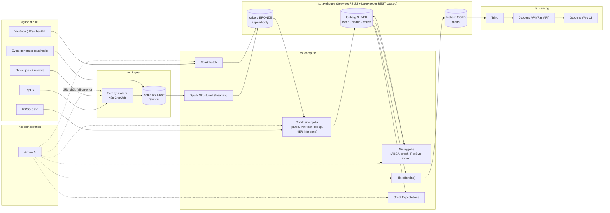

> [← Mục lục](README.md)

# Nền tảng dữ liệu (Big Data Storage & Processing)

## Sơ đồ tổng quan

Khung này bám đúng "four-layer stack" của L01 và sơ đồ L14: **Store** (SeaweedFS + Iceberg), **Move** (Kafka), **Process** (Spark batch/streaming), **Query/Analyze** (Trino, Spark ML), **Integrate** (dbt + GX + Airflow).

## Thiết kế Kafka (L08)

| Topic | Key (partition key) | Partitions (đề xuất) | Retention | Ghi chú |
|---|---|---|---|---|
| `jobs.raw.topcv.v1` | `source_job_id` | 6 | 7 ngày | Cùng một tin luôn vào cùng partition → giữ thứ tự các lần crawl của tin đó |
| `jobs.raw.itviec.v1` | `source_job_id` | 6 | 7 ngày | |
| `reviews.raw.itviec.v1` | `company_id` | 3 | 7 ngày | |
| `events.user.v1` | `user_id` | 6 | 3 ngày | Luồng synthetic cho streaming + RecSys |
| `dlq.parse_errors.v1` | `source` | 1 | 14 ngày | Bản ghi lỗi parse, để GX/BD báo cáo tỉ lệ lỗi |

Producer: `acks=all`, idempotent producer bật; value là JSON có `schema_version`, `source`, `url`, `crawl_ts`, `content_hash`, payload. Consumer group riêng cho từng đường (streaming bronze, kiểm thử). Replay từ Kafka + time travel của Iceberg là cơ chế tái xử lý (tinh thần Kappa, L09).

## Thiết kế bảng Iceberg (L03, L04)

| Zone | Bảng | Partition spec (đề xuất) | Ghi theo kiểu | Nội dung |
|---|---|---|---|---|
| Bronze | `bronze.jobs_raw` | `days(ingest_ts)`, `source` | append | Payload thô + metadata crawl |
| | `bronze.reviews_raw` | `days(ingest_ts)` | append | |
| | `bronze.user_events` | `hours(event_ts)` | append (streaming) | |
| Silver | `silver.job_postings` | `months(posted_date)`, `bucket(16, job_uid)` | `MERGE INTO` (upsert theo `job_uid`) | Tin đã chuẩn hóa: lương min/max VND, tỉnh/thành (34), cấp bậc, loại hợp đồng, `dup_group_id` |
| | `silver.job_postings_snapshot` | `days(snapshot_date)` | append | Trạng thái tin mỗi ngày → vòng đời tin, biến động lương |
| | `silver.job_skills` | `bucket(16, job_uid)` | overwrite theo partition | `job_uid, skill_id, surface_form, span, confidence, extractor_version` |
| | `silver.review_aspects` | `months(review_date)` | append | `company_id, aspect, polarity, confidence, model_version` |
| Gold (dbt) | `dim_skill`, `dim_company`, `dim_location`, `fct_job_snapshot_daily` | theo thời gian | dbt model | Mô hình sao cho Trino |
| | `mart_skill_demand_monthly`, `mart_salary_role_region`, `mart_skill_graph_edges`, `mart_company_aspect_sentiment`, `mart_job_reco_candidates` | | dbt model | Phục vụ trực tiếp các ca sử dụng |

Định dạng file Parquet (L03), có job compaction/expire snapshot định kỳ (L14 "Cost"). Mỗi lần "chốt số liệu" cho báo cáo, gắn **Iceberg tag** (ví dụ `report-bd-v1`) để số liệu tái lập được.

## Batch vs streaming – thí nghiệm bắt buộc theo L14

Cùng một mart (ví dụ `mart_skill_demand_daily`) được nuôi bằng hai đường:

- **Đường A – batch-only:** crawler ghi file → Spark batch mỗi giờ → bronze.
- **Đường B – streaming bronze:** Kafka → Spark Structured Streaming (trigger 1 phút, checkpoint, watermark theo `crawl_ts`) → bronze.

So sánh: độ tươi dữ liệu (freshness), chi phí (CPU-giây, bộ nhớ), số file nhỏ sinh ra, độ đúng (số dòng/khóa khớp nhau), độ phức tạp vận hành. Kết quả dùng để viết một **Architecture Decision Record** (Lambda hay Kappa, L09) – ADR này thuộc báo cáo Big Data; báo cáo SA&D chỉ trích quyết định cuối cùng.

## Triển khai trên Kubernetes

| Namespace | Thành phần | Cách deploy (đề xuất) |
|---|---|---|
| `ingest` | Strimzi operator + Kafka (KRaft, 1 broker combined cho môi trường dev), Scrapy CronJob, event-generator Deployment | Strimzi Helm/YAML; CronJob |
| `lakehouse` | SeaweedFS (S3 gateway), Lakekeeper (Iceberg REST catalog), PostgreSQL | Helm |
| `compute` | Spark driver/executor pods | `spark-submit --master k8s://…` (đúng L10); Kubeflow Spark Operator là lựa chọn thêm |
| `orchestration` | Airflow 3 (KubernetesExecutor, KubernetesPodOperator) | Helm chart chính thức |
| `serving` | Trino (1 coordinator + 1 worker), JobLens API, UI | Helm `trinodb/charts`; Deployment |
| `monitoring` | Prometheus + Grafana, Kafka exporter | kube-prometheus-stack |

**Cluster:** k3d (k3s trong Docker) 1 server + 2 agent trên một máy, hoặc kind; nếu máy yếu thì thuê 1 VM cloud bằng credit sinh viên.

**Ngân sách tài nguyên (ước lượng, cần đo lại):** Kafka ~1,5 GB · Spark driver + 2 executor ~3–4 GB khi chạy · Trino ~3 GB · Airflow ~2 GB · Postgres + SeaweedFS + Lakekeeper ~1,5 GB · Prometheus/Grafana ~1 GB · API/UI ~0,5 GB → **đỉnh ~12–14 GB RAM**. Máy 16 GB chạy được nếu không bật Spark job và Trino cùng lúc; khuyến nghị máy 32 GB hoặc VM cloud cho buổi demo.

## Tech stack đề xuất

Phiên bản ghi theo tình trạng cuối 09/2026; khi dựng môi trường nhóm **pin phiên bản trong `joblens-contracts/versions.md`** và chỉ nâng cấp có chủ đích.

| Tầng | Đề xuất | Phiên bản gợi ý | Lý do / bài giảng liên quan | Phương án thay thế |
|---|---|---|---|---|
| Orchestrator K8s local | k3d | bản mới nhất | Nhẹ, multi-node trên 1 máy | kind, minikube |
| Messaging | Apache Kafka qua **Strimzi** | Strimzi 1.2 (hỗ trợ Kafka 4.2–4.3), KRaft, không ZooKeeper | L08; operator chuẩn trên K8s ([Strimzi KRaft](https://strimzi.io/kraft/)) | Redpanda |
| Xử lý | **Apache Spark** | **4.1.x** (4.2 vừa ra 07/2026 – chưa nên dùng vì connector chưa theo kịp) ([endoflife.date](https://endoflife.date/apache-spark)) | L10, L11, L13; Iceberg 1.11 build mặc định cho Spark 4.1 | Flink (L12) cho đường streaming nếu muốn so sánh thêm |
| Table format | **Apache Iceberg** | 1.11 (JDK 17; Spark 4.1 hỗ trợ `MERGE INTO … WITH SCHEMA EVOLUTION`) ([Google OSS blog](https://opensource.googleblog.com/2026/05/announcing-apache-iceberg-1110.html)) | L04, L14 | Delta, Hudi (L04) |
| Catalog | **Lakekeeper** (Iceberg REST, Rust, nhẹ) | 0.12+ | Dễ chạy trên K8s, hỗ trợ tốt Spark/Trino/PyIceberg ([tổng quan catalog 06/2026](https://dev.to/alexmercedcoder/the-state-of-apache-iceberg-catalogs-in-june-2026-265e)) | Apache Polaris 1.4 (đã là Apache TLP), Nessie |
| Object storage | **SeaweedFS** (S3 API) | bản ổn định mới nhất | **MinIO Community đã vào chế độ bảo trì từ 12/2025**, không còn bảo đảm vá bảo mật ([Elest.io](https://blog.elest.io/rustfs-vs-seaweedfs-vs-garage-which-minio-alternative-should-you-pick/)) | Garage (AGPL), Ceph RGW, (MinIO bản cũ nếu GV dùng trong lab) |
| Transform | **dbt Core 1.x + dbt-trino** | dbt Core 1.x (Python) | L14 "dbt owns SQL gold". dbt v2 (Fusion) mới phát hành 14/09/2026 ([DuckDB blog](https://duckdb.org/2026/09/22/dbt-fusion)) – chưa rõ adapter Trino/Spark nên giữ 1.x | dbt-spark |
| Data quality | **Great Expectations (GX Core)** | 1.23.x; hỗ trợ Spark 4 từ 1.19 ([changelog](https://docs.greatexpectations.io/docs/core/changelog/)) | L14 "GE + dbt tests gate publish" | Soda, dbt tests thuần |
| Orchestration | **Apache Airflow 3** | 3.3.x, Helm chart chính thức ([docs](https://airflow.apache.org/docs/apache-airflow/stable/administration-and-deployment/kubernetes.html)) | L14 "Airflow runs the graph" | Dagster |
| Query | **Trino** | 483 ([Iceberg connector](https://trino.io/docs/current/connector/iceberg.html), [Helm](https://trino.io/docs/current/installation/kubernetes.html)) | L07 | Spark SQL Thrift, DuckDB (dev) |
| Metadata DB | PostgreSQL | 16/17 | Airflow + Lakekeeper | |
| Monitoring | Prometheus + Grafana | kube-prometheus-stack | Đo lag, latency cho báo cáo BD | |
| Crawl | Scrapy 2.x (+ scrapy-playwright khi trang render JS) | | L01, L04 (web crawling, tiền xử lý) | Playwright thuần |
| NLP tiếng Việt | underthesea / VnCoreNLP (tách từ – PhoBERT cần đầu vào đã tách từ), **PhoBERT-base-v2**, ViSoBERT, [bkai vietnamese-bi-encoder](https://huggingface.co/bkai-foundation-models/vietnamese-bi-encoder) (embedding) | | L06, L07, L04 | LLM zero/few-shot làm baseline (như VietJobs) |
| ML trên Spark | Spark ML: `MinHashLSH` (dedup), `ALS` (CF), pipeline + CrossValidator | theo Spark 4.1 | L13, L08 | |
| Đồ thị | GraphFrames hoặc NetworkX (trên mart cạnh đã tổng hợp) | | L05 (Web Mining) | |
| Ứng dụng | FastAPI + trino-python-client; UI Streamlit hoặc React | | SA&D chương 5 | |
| Mô hình hóa UML | draw.io / StarUML / PlantUML | | Công cụ liệt kê trong l00 | |

## Metrics nền tảng

Mỗi metric thuộc về **đúng một môn** (quy tắc R4 trong [Quy tắc phân tách](07-quy-tac-phan-tach-mon.md)). Chỉ tiêu là đề xuất để nhóm có đích nhắm, sẽ hiệu chỉnh sau khi có số đo đầu tiên.

| Metric | Định nghĩa | Chỉ tiêu đề xuất |
|---|---|---|
| Throughput ingest | bản ghi/giây vào Kafka và vào bronze | đo & báo cáo; kiểm thử tải với event-generator ở 3 mức |
| Consumer lag | chênh offset của group streaming | ổn định, không tăng liên tục ở mức tải chuẩn |
| End-to-end freshness | `gold_available_ts − crawl_ts` | batch ≤ 1–2 giờ; streaming bronze ≤ 2 phút |
| Chi phí xử lý | CPU-giây, GB-giờ bộ nhớ mỗi lần chạy | so sánh đường A vs B (mục Batch vs streaming) |
| Sức khỏe bảng | số file nhỏ, kích thước file trung bình, số snapshot | trước/sau compaction |
| Chất lượng dữ liệu | tỉ lệ expectation GX pass, số bản ghi DLQ | 100% gold pass |
| Hiệu năng truy vấn | p50/p95 Trino trên các mart, hiệu quả partition pruning | p95 ≤ 3 giây cho truy vấn dashboard |
| Độ đúng xử lý | khớp số dòng/khóa giữa đường batch và streaming; kiểm thử replay | chênh lệch 0 sau khi hội tụ |
