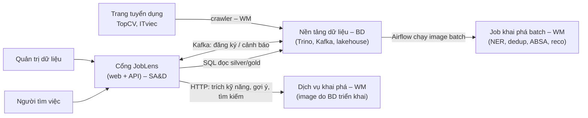
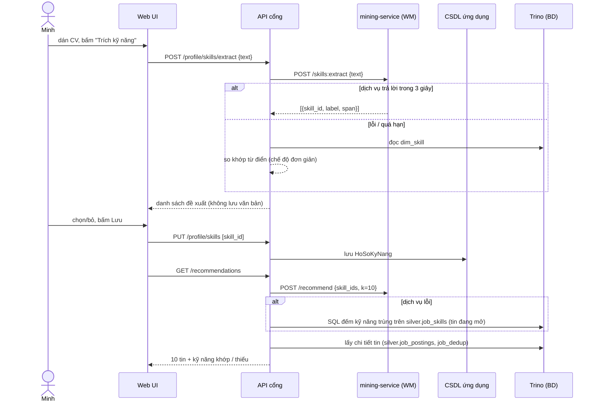
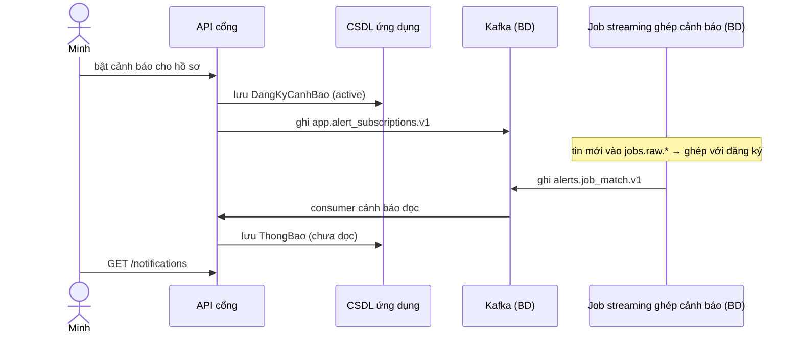
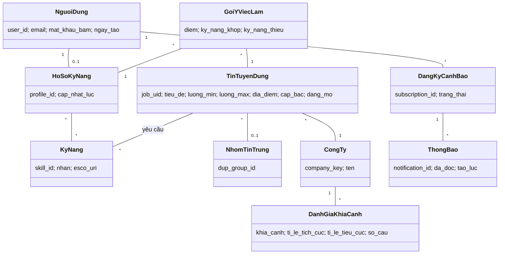

> [← Mục lục](README.md)

# Blueprint hệ thống JobLens (bản chốt phạm vi cho SA&D)

| | |
|---|---|
| **Trạng thái** | ĐỀ XUẤT – chờ nhóm duyệt (các điểm cần chốt ở [mục 15](#15-quyết-định-cần-chốt)) |
| **Ngày** | 2026-10-12 |
| **Người soạn** | Hoang Le (nháp bằng Claude Code) |
| **Thay thế** | Phần "Ca sử dụng đề xuất" của [05](05-phan-tich-thiet-ke-he-thong.md) và các dòng UC của [06](06-ma-tran-lien-ket.md) khi được duyệt |

Tài liệu này là bản vẽ chung để cả ba nhóm dựng hệ thống: **ai dùng, dùng thế nào, có chức năng gì, kiến trúc ra sao, dữ liệu nằm ở đâu, ai làm phần nào**. Nó là kế hoạch, không phải báo cáo: báo cáo SA&D vẫn do người học SA&D viết và vẽ lại bằng UML (R5, R7).

---

## 1. Tầm nhìn và phạm vi

**Một câu:** JobLens giúp **người tìm việc IT** tìm việc hợp với kỹ năng của mình, biết nên học thêm gì và biết công ty có đáng vào không, dựa trên tin tuyển dụng và review công ty thu thập từ các trang tuyển dụng Việt Nam.

**Tiêu chí giữ một chức năng:** ít nhất hai môn có phần việc thật ở phía sau. Chức năng chỉ là "tính năng web thông thường" thì bỏ hoặc làm tối thiểu.

| Trong phạm vi | Ngoài phạm vi |
|---|---|
| Tin tuyển dụng IT tự crawl (TopCV, ITviec) – dữ liệu chính; review công ty công khai trên ITviec. VietJobs chỉ dùng phía sau (nhãn yếu, đo tải) – [docs/13](13-kham-pha-du-lieu.md) | Ngành ngoài IT; nộp hồ sơ ứng tuyển qua hệ thống |
| Tìm việc, xem chi tiết tin, hồ sơ kỹ năng, gợi ý việc, xu hướng kỹ năng, review theo khía cạnh, cảnh báo tin mới | Nhà tuyển dụng đăng tin, quản lý ứng viên |
| Tài khoản đơn giản (email + mật khẩu) | Đăng nhập Google/Facebook, thanh toán |
| Trang tình trạng dữ liệu cho quản trị (chỉ đọc) | Giao diện quản lý crawler, lập lịch (dùng Airflow UI) |
| Ô tìm kiếm hiểu câu tự nhiên bằng mô hình của nhóm (tùy chọn) | Chatbot LLM |

**Vì sao không làm chatbot LLM:** nằm ngoài nội dung cả ba môn, khó đánh giá, dễ trả lời bịa, tốn chi phí API. Ô tìm kiếm tự tách câu bằng mô hình WM2/WM3 vừa đủ "thông minh" vừa khớp bài Query Mining của Web Mining.

---

## 2. Người dùng

### 2.1 Persona chính – Minh, sinh viên năm cuối / fresher IT

| | |
|---|---|
| **Hồ sơ** | 22 tuổi, học CNTT, biết Java, SQL, một ít ReactJS qua đồ án. Tìm việc thực tập hoặc fresher ở Hà Nội. Có CV dạng PDF/Word |
| **Mục tiêu** | Tìm việc đầu tiên hợp kỹ năng; công ty có đào tạo, ít OT |
| **Khó khăn** | Một tin đăng lại trên nhiều trang nên đọc lặp; không biết mình đủ kỹ năng cho tin nào; không biết nên học thêm gì; sợ môi trường tệ nhưng review rải rác, khó đọc |
| **Thói quen** | Dùng điện thoại và laptop; quen gõ từ khóa ngắn ("java fresher hà nội") |
| **Thành công khi** | Trong 5 phút có danh sách 10 tin phù hợp kèm lý do, biết 1–2 kỹ năng nên học, và biết công ty nào bị chê về OT |

**Vì sao chọn Minh:** dữ liệu là tin IT; fresher tìm việc chủ yếu bằng kỹ năng (chưa có nhiều kinh nghiệm), nên mọi mô hình WM đều có chỗ dùng; nhóm là sinh viên IT nên hiểu rõ nhu cầu, dễ viết user story và dễ demo.

### 2.2 Persona phụ – Hà, dev 3–5 năm muốn đổi việc (tùy chọn)

Backend 4 năm ở TP.HCM. Dùng chủ yếu **review công ty** (so hai công ty về lương, quản lý) và **cảnh báo** tin Senior mới. Giữ Hà nếu nhóm SA&D cần thêm user story cho UC005/UC006; Minh đã phủ đủ mọi UC.

### 2.3 Actor

| Actor | Loại | Vai trò |
|---|---|---|
| **Người tìm việc** (khách) | Người | Tìm việc, xem chi tiết, xem xu hướng, xem review – không cần tài khoản |
| **Người tìm việc** (thành viên) | Người – kế thừa từ khách | Thêm: hồ sơ kỹ năng, gợi ý, cảnh báo |
| **Quản trị dữ liệu** | Người | Xem tình trạng dữ liệu (chỉ đọc). Giữ để biểu đồ UC có hơn một actor người |
| **Nền tảng dữ liệu JobLens** | Hệ thống | Cung cấp dữ liệu đã xử lý (Trino) và luồng cảnh báo (Kafka) – do nhóm BD vận hành |
| **Dịch vụ khai phá** | Hệ thống | Trích kỹ năng, gợi ý, tìm kiếm – image do nhóm WM làm |

Trang tuyển dụng bên ngoài và Airflow Scheduler không còn là actor của cổng: chúng tương tác với nền tảng dữ liệu, không với ứng dụng.

---

## 3. Cách người dùng tương tác

| # | Cách | Người dùng làm gì | Phía sau | Mức |
|---|---|---|---|---|
| T1 | **Tra cứu** | Gõ từ khóa, chọn bộ lọc, xem dashboard | Tìm kiếm trên tin đã khử trùng (WM1, WM4), mart (BD) | Bắt buộc |
| T2 | **Dán CV / mô tả bản thân** | Dán văn bản → hệ thống tự trích kỹ năng → người dùng sửa, lưu thành hồ sơ | Mô hình trích kỹ năng WM2 chạy trên văn bản người dùng | Bắt buộc |
| T3 | **Hệ thống chủ động** | Trang chủ hiện việc hợp; thông báo tin mới khớp hồ sơ; gợi ý "học thêm X mở thêm N tin" | WM5 gợi ý; BD streaming ghép cảnh báo; WM2 + thống kê cho khoảng trống kỹ năng | Bắt buộc (gợi ý, khoảng trống) / Nên (cảnh báo) |
| T4 | **Câu tự nhiên** | "việc java fresher hà nội công ty không OT" | Tách thành bộ lọc: kỹ năng (WM2), địa điểm (từ điển), cấp bậc (quy tắc), "không OT" → lọc theo khía cạnh review (WM3) | Tùy chọn |

**Nguyên tắc riêng tư cho T2:** văn bản CV chỉ xử lý trong bộ nhớ, **không lưu**; chỉ lưu danh sách kỹ năng người dùng đã xác nhận. Màn hình ghi rõ điều này.

---

## 4. Ca sử dụng

Giữ nguyên mã UC cũ để các contract đang tham chiếu (`used_by: UC001…`) không bị lệch. UC bỏ thì ghi "bỏ", không dùng lại mã.

### 4.1 Danh sách

| UC | Tên | Actor | Mức | Cách tương tác | Môn có phần việc |
|---|---|---|---|---|---|
| UC001 | Tìm kiếm việc làm | Khách | P0 | T1, T4 | WM1 dedup, WM4 (tùy chọn) · BD silver/Trino · SA&D |
| UC011 | Xem chi tiết tin tuyển dụng *(mới)* | Khách | P0 | T1 | WM1 (tin này có trên những trang nào), WM2 (kỹ năng của tin, kỹ năng khớp hồ sơ), WM3 (tóm tắt review công ty) · BD |
| UC004 | Lập hồ sơ kỹ năng | Thành viên | P0 | T2 | WM2 (trích từ văn bản) · SA&D |
| UC012 | Nhận gợi ý việc làm *(tách từ UC004 cũ)* | Thành viên | P0 | T3 | WM5 · BD (chạy mô hình, dữ liệu) |
| UC005 | Xem đánh giá công ty theo khía cạnh | Khách | P0 | T1 | WM3 · BD mart |
| UC010 | Đăng ký / đăng nhập | Khách → Thành viên | P0 | – | SA&D |
| UC002 | Xem xu hướng nhu cầu kỹ năng | Khách | P1 | T1, T3 | WM2 · BD gold (dbt) |
| UC013 | Xem khoảng trống kỹ năng *(mới)* | Thành viên | P1 | T3 | WM2, WM5 · BD |
| UC006 | Đăng ký và nhận cảnh báo tin mới | Thành viên | P1 | T3 | BD streaming (thí nghiệm bắt buộc của BD) · SA&D (pub-sub) |
| UC009 | Xem tình trạng dữ liệu *(thu gọn)* | Quản trị dữ liệu | P1 | T1 | BD (GX, độ tươi), WM1 (tỉ lệ lỗi parse) |
| UC003 | So sánh mức lương | Khách | P2 | T1 | BD (chuẩn hóa lương) |
| UC007 | ~~Xuất báo cáo thị trường~~ | | **bỏ** | | không môn nào cần |
| UC008 | ~~Quản lý nguồn thu thập~~ | | **bỏ** | | dùng Airflow UI của BD |

**P0** = phải có cho demo đầu tiên; **P1** = phải có trước khi nộp; **P2** = làm nếu còn thời gian.

### 4.2 Quan hệ giữa các UC (để vẽ biểu đồ UC)

- UC004 **include** "Trích kỹ năng từ văn bản".
- UC012 **include** "Lấy hồ sơ kỹ năng"; UC012 có điều kiện trước: đã có hồ sơ (UC004).
- UC013 **extend** UC012 (điểm mở rộng: "xem vì sao chưa khớp").
- UC011 **extend** UC001 (chọn một tin trong danh sách); UC011 **include** "Tóm tắt review công ty" (dùng lại phần của UC005).
- UC006 **extend** UC012 ("theo dõi hồ sơ này").
- UC004, UC012, UC013, UC006 yêu cầu đăng nhập (UC010).

### 4.3 Câu chuyện demo xuyên suốt (dùng cho cả 3 môn)

```
Minh vào trang chủ (khách)
 → tìm "java fresher hà nội" (UC001)        ── tin trùng TopCV/ITviec chỉ hiện 1 lần (WM1)
 → mở một tin (UC011)                       ── thấy kỹ năng của tin, "có trên TopCV và ITviec", công ty bị chê OT (WM2, WM3)
 → đăng ký tài khoản (UC010)
 → dán CV → hệ thống trích Java, SQL, ReactJS → Minh bỏ một kỹ năng, lưu (UC004, WM2)
 → trang chủ hiện 10 tin, mỗi tin ghi "khớp 3/4 kỹ năng" (UC012, WM5)
 → "Học thêm Spring Boot sẽ khớp thêm 40 tin" (UC013)
 → xem trang công ty A theo 6 khía cạnh (UC005, WM3)
 → bật cảnh báo; vài phút sau có tin mới khớp → thông báo (UC006, BD streaming)
```

---

## 5. User story và tiêu chí chấp nhận (mẫu cho P0)

Nhóm SA&D viết đầy đủ trong `PTTKHT-joblens/requirements/`; dưới đây là bản mẫu để thống nhất cách hiểu.

**US-01 (UC001)** – Là người tìm việc, tôi muốn tìm theo từ khóa và lọc theo địa điểm, cấp bậc, để chỉ xem tin liên quan.
- Given có tin "Java Developer" của công ty X đăng trên cả TopCV và ITviec, When tôi tìm "java" lọc "Hà Nội", Then tin đó hiện **một lần**, ghi "có trên 2 trang".
- Given không có tin nào khớp, When tôi tìm, Then hệ thống báo không có kết quả và gợi ý bỏ bớt bộ lọc.

**US-02 (UC004)** – Là thành viên, tôi muốn dán CV để hệ thống tự điền kỹ năng, để không phải gõ từng kỹ năng.
- Given tôi dán đoạn có "Java, Spring Boot và MySQL", When bấm "Trích kỹ năng", Then danh sách đề xuất gồm Java, Spring Boot, MySQL, mỗi mục bỏ chọn được.
- Given tôi đã lưu hồ sơ, When xem lại, Then **không** thấy văn bản CV gốc, chỉ thấy kỹ năng đã lưu.
- Given dịch vụ khai phá không phản hồi, When bấm "Trích kỹ năng", Then hệ thống vẫn trả kết quả bằng từ điển và ghi "chế độ đơn giản".

**US-03 (UC012)** – Là thành viên có hồ sơ kỹ năng, tôi muốn thấy các tin phù hợp nhất, kèm lý do.
- Given hồ sơ có Java, SQL, When mở trang Gợi ý, Then thấy tối đa 10 tin đang mở, mỗi tin ghi kỹ năng khớp và kỹ năng còn thiếu.
- Given hồ sơ rỗng, When mở trang Gợi ý, Then hệ thống dẫn tới trang lập hồ sơ.

**US-04 (UC005)** – Là người tìm việc, tôi muốn xem công ty được khen chê thế nào theo từng khía cạnh.
- Given công ty có ≥ 10 câu review về "lương", When mở trang công ty, Then thấy tỉ lệ tích cực/tiêu cực của khía cạnh đó và vài câu ví dụ.
- Given khía cạnh có < 10 câu, Then hiển thị "chưa đủ dữ liệu" thay vì tỉ lệ.

**US-05 (UC011)** – Là người tìm việc, tôi muốn xem đủ thông tin một tin ở một chỗ.
- Given tin có kỹ năng đã trích, When mở chi tiết, Then thấy danh sách kỹ năng, lương đã chuẩn hóa, link tới trang gốc, tóm tắt review công ty (nếu có).

---

## 6. Màn hình (sitemap)

| Màn hình | UC | Nội dung chính |
|---|---|---|
| Trang chủ | UC001, UC012, UC002 | Ô tìm kiếm; khách: kỹ năng hot tháng này; thành viên: 10 tin gợi ý + 1 gợi ý học thêm |
| Kết quả tìm kiếm | UC001 | Danh sách tin (đã gộp trùng), bộ lọc địa điểm/cấp bậc/kỹ năng/lương |
| Chi tiết tin | UC011 | Thông tin tin, kỹ năng (đánh dấu kỹ năng khớp hồ sơ), các trang có tin này, tóm tắt review công ty, link gốc |
| Hồ sơ kỹ năng | UC004 | Ô dán văn bản → danh sách đề xuất → chọn/bỏ/thêm tay → lưu |
| Gợi ý việc làm | UC012, UC013 | 10 tin + lý do; khối "nên học thêm" |
| Xu hướng kỹ năng | UC002 | Top kỹ năng theo tháng, biểu đồ thay đổi, lọc theo nhóm |
| Trang công ty | UC005 | 6 khía cạnh × tỉ lệ cảm xúc, câu ví dụ, điểm sao trung bình |
| Cảnh báo & thông báo | UC006 | Bật/tắt theo dõi hồ sơ, danh sách thông báo |
| Đăng ký / đăng nhập | UC010 | Email + mật khẩu |
| Tình trạng dữ liệu | UC009 | Theo nguồn: lần cập nhật cuối, số tin, tỉ lệ lỗi parse, tỉ lệ GX đạt |
| *(P2)* So sánh lương | UC003 | Lương theo vị trí × tỉnh |

---

## 7. Yêu cầu phi chức năng (bản sửa)

| NFR | Phát biểu | Kiểm thử | Bằng chứng từ |
|---|---|---|---|
| Hiệu năng trang | 95% yêu cầu tới API của cổng (UC001, UC002, UC005, UC011) trả về ≤ 3 giây với 20 người dùng đồng thời | Script tải (locust/k6) | SA&D |
| Hiệu năng trích kỹ năng | 95% yêu cầu trích kỹ năng với văn bản ≤ 3.000 ký tự trả về ≤ 3 giây trên CPU | Script tải gọi UC004 | SA&D (dịch vụ của WM) |
| Chịu lỗi | Khi dịch vụ khai phá hoặc dịch vụ tìm kiếm lỗi, UC001/UC004/UC012 vẫn trả kết quả bằng đường lùi trong ≤ 5 giây | Tắt dịch vụ rồi chạy kịch bản chấp nhận | SA&D |
| Độ tươi | Tin mới xuất hiện ở UC001 ≤ 24 giờ sau khi crawl; cảnh báo UC006 ≤ 5 phút sau khi tin vào Kafka | So `crawl_ts` với thời điểm hiển thị | trích số đo BD (`report-bd-v1`) |
| Riêng tư | Không lưu văn bản CV; mật khẩu băm bằng thuật toán chậm (argon2/bcrypt); không có cột PII ở silver/gold | Test tự động + review code | SA&D, BD |
| Khả năng dùng | Người dùng mới hoàn thành "dán CV → xem gợi ý" trong ≤ 3 phút không cần hướng dẫn | Thử với 5 người, đo thời gian | SA&D |
| Chạy độc lập | Cổng chạy được với gold mẫu (DuckDB/Parquet từ fixtures), không cần Trino, Kafka, dịch vụ khai phá | CI chạy kịch bản chấp nhận ở chế độ local | SA&D |
| Triển khai lại | Dựng lại toàn bộ từ repo ≤ 30 phút | Chạy thử trên máy sạch | BD, SA&D |

---

## 8. Kiến trúc tổng thể

### 8.1 Ngữ cảnh hệ thống (mức 1)



### 8.2 Thành phần (mức 2)

| Thành phần | Repo / chủ | Công nghệ (đề xuất) | Vai trò |
|---|---|---|---|
| **Web UI** | PTTKHT | React + Vite (TypeScript) | Giao diện, gọi API cổng |
| **API cổng** | PTTKHT | FastAPI (Python 3.12) | Boundary + Control: xác thực, nghiệp vụ, ghép dữ liệu |
| **CSDL ứng dụng** | PTTKHT | PostgreSQL (schema `app`) | Tài khoản, hồ sơ kỹ năng, đăng ký cảnh báo, thông báo |
| **Consumer cảnh báo** | PTTKHT | tiến trình Python trong API hoặc worker riêng | Đọc `alerts.job_match.v1`, ghi bảng thông báo |
| **Dịch vụ khai phá** (`mining-service`) | WM viết, BD triển khai | FastAPI + mô hình WM2/WM5 | `POST /skills:extract`, `POST /recommend`; kèm stub |
| **Dịch vụ tìm kiếm** (`search-service`, tùy chọn) | WM viết, BD triển khai | BM25/hybrid (WM4) | `GET /search` theo `schemas/api/search.v1.yaml` |
| **Trino + lakehouse** | BD | Trino 483, Iceberg | Đọc `silver.job_postings`, `silver.job_dedup`, `silver.job_skills`, `silver.review_aspects`, các bảng gold |
| **Kafka** | BD | Strimzi | `app.alert_subscriptions.v1` (app ghi), `alerts.job_match.v1` (app đọc) |
| **Job batch khai phá** | WM viết, BD chạy (Airflow) | image Docker | Ghi `silver.job_skills`, `silver.job_dedup`, `silver.review_aspects`, `silver.reco_scores` |

**Phân biệt hai loại lưu trữ:** lakehouse (BD) là **dữ liệu phân tích, chỉ đọc** với cổng. CSDL ứng dụng (PTTKHT) là **dữ liệu giao dịch của người dùng**. Quy tắc "app không ghi bảng nào" trong `AGENTS.md` nghĩa là không ghi bảng lakehouse; CSDL riêng của cổng thì cổng ghi.

### 8.3 Kiểu kiến trúc

| Kiểu | Áp dụng ở | Lý do |
|---|---|---|
| **Layered** | Bên trong API cổng | Tách Presentation – Application – Domain – Infrastructure; khớp ECB của môn |
| **Client–server / SPA** | Web UI ↔ API | Tách giao diện khỏi nghiệp vụ, API kiểm thử được độc lập |
| **Event-driven (pub-sub)** | UC006 qua Kafka | Cảnh báo bất đồng bộ; cổng không phải hỏi liên tục |
| **Service-based** | Cổng ↔ dịch vụ khai phá, dịch vụ tìm kiếm, Trino | Mô hình nặng (PyTorch) tách khỏi cổng; mỗi nhóm triển khai độc lập; có đường lùi |

---

## 9. Bốn + một góc nhìn (4+1)

### 9.1 Logical view – lớp và ECB

```
Presentation   Web UI (pages, components)
──────────────────────────────────────────────────────────────
Boundary       FastAPI routers: /jobs /profile /recommendations /companies /trends /alerts /auth /admin
──────────────────────────────────────────────────────────────
Control        SearchService · JobDetailService · ProfileService · RecommendationService
               SkillGapService · CompanyInsightService · TrendService · AlertService · AuthService · DataStatusService
──────────────────────────────────────────────────────────────
Entity         NguoiDung · HoSoKyNang · KyNang · TinTuyenDung · NhomTinTrung · CongTy
               DanhGiaKhiaCanh · GoiYViecLam · DangKyCanhBao · ThongBao · DiaDiem
──────────────────────────────────────────────────────────────
Infrastructure JobRepository / CompanyRepository / TrendRepository (Trino | DuckDB)
               UserRepository / ProfileRepository / AlertRepository (PostgreSQL)
               MiningClient (HTTP | từ điển) · SearchClient (HTTP | Trino) · AlertPublisher/Consumer (Kafka | bộ nhớ)
```

| UC | Boundary | Control | Entity chính |
|---|---|---|---|
| UC001 | `JobsRouter`, `SearchPage` | `SearchService` | TinTuyenDung, NhomTinTrung, DiaDiem |
| UC011 | `JobsRouter`, `JobDetailPage` | `JobDetailService` | TinTuyenDung, KyNang, CongTy, DanhGiaKhiaCanh |
| UC004 | `ProfileRouter`, `ProfilePage` | `ProfileService` | HoSoKyNang, KyNang |
| UC012 | `RecoRouter`, `RecoPage` | `RecommendationService` | GoiYViecLam, HoSoKyNang, TinTuyenDung |
| UC013 | `RecoRouter` | `SkillGapService` | KyNang, HoSoKyNang |
| UC005 | `CompaniesRouter`, `CompanyPage` | `CompanyInsightService` | CongTy, DanhGiaKhiaCanh |
| UC002 | `TrendsRouter`, `TrendPage` | `TrendService` | KyNang |
| UC006 | `AlertsRouter`, `AlertPage` | `AlertService` | DangKyCanhBao, ThongBao |
| UC010 | `AuthRouter`, `LoginPage` | `AuthService` | NguoiDung |
| UC009 | `AdminRouter`, `DataStatusPage` | `DataStatusService` | (đọc số liệu từ BD) |

### 9.2 Process view – luồng chính

**UC004 + UC012: dán CV → gợi ý (đồng bộ, có đường lùi)**



**UC006: cảnh báo (bất đồng bộ)**



**UC001: tìm kiếm** – API gọi `search-service` nếu có `JOBLENS_SEARCH_URL` và `/health` báo ổn; nếu không thì truy vấn Trino (`ILIKE` trên tiêu đề + lọc), gộp theo `dup_group_id` (ADR 0001 D4a, D5).

### 9.3 Development view – cấu trúc code

```
PTTKHT-joblens/
├── api/
│   ├── routers/        # Boundary
│   ├── services/       # Control
│   ├── domain/         # Entity (dataclass/pydantic)
│   ├── repositories/   # Repository: trino_*.py, duckdb_*.py, postgres_*.py
│   ├── clients/        # MiningClient, SearchClient (+ bản lùi)
│   ├── messaging/      # AlertPublisher, AlertConsumer (+ bản bộ nhớ)
│   └── settings.py     # chọn adapter theo biến môi trường
├── web/                # React + Vite
├── scripts/make_sample_gold.py
├── tests/{unit,acceptance}/
├── uml/  requirements/  docs/
```

Chọn adapter theo môi trường (không sửa code):

| Biến | Có | Không có |
|---|---|---|
| `JOBLENS_TRINO_HOST` | Repository dùng Trino | DuckDB đọc gold mẫu |
| `JOBLENS_MINING_URL` | MiningClient gọi HTTP | Trích bằng từ điển, gợi ý bằng đếm kỹ năng trùng |
| `JOBLENS_SEARCH_URL` | SearchClient gọi HTTP | Tìm bằng Trino/DuckDB |
| `JOBLENS_KAFKA_BOOTSTRAP` | Kafka thật | Hàng đợi trong bộ nhớ (demo local) |

### 9.4 Physical view – triển khai

| Node (namespace K8s) | Artifact | Chủ triển khai |
|---|---|---|
| `serving` | `joblens-web`, `joblens-api`, `alert-consumer`, PostgreSQL `app` | PTTKHT viết manifest/Helm values, BD áp vào cụm (hoặc PTTKHT tự áp nếu được cấp quyền) |
| `serving` | `mining-service`, `search-service` (tùy chọn), Trino | BD (image của WM) |
| `ingest` | Kafka | BD |
| Trình duyệt người dùng | SPA tĩnh | – |
| **Chế độ local** (máy dev, CI) | `docker compose`: api + web + postgres; DuckDB gold mẫu; không Kafka, không mining-service | PTTKHT |

Biểu đồ deployment trong báo cáo SA&D vẽ lại bằng ký pháp UML (node, artifact, communication path), không dán sơ đồ Helm (R5).

### 9.5 Scenarios (+1)

Ba kịch bản dùng để kiểm chứng cả 4 góc nhìn: (1) câu chuyện demo ở mục 4.3; (2) dịch vụ khai phá bị tắt giữa lúc demo – hệ thống chuyển sang chế độ đơn giản; (3) tin mới vào Kafka → thông báo trong ≤ 5 phút.

---

## 10. Thiết kế dữ liệu

### 10.1 Mô hình miền (domain model)



### 10.2 CSDL ứng dụng (PostgreSQL, schema `app`) – PTTKHT sở hữu

| Bảng | Cột chính | Ghi chú |
|---|---|---|
| `user_account` | `user_id`, `email` (unique), `password_hash`, `role` (`member`/`admin`), `created_at` | |
| `skill_profile` | `profile_id`, `user_id`, `updated_at` | Một người một hồ sơ (bản đầu) |
| `profile_skill` | `profile_id`, `skill_id`, `source` (`extracted`/`manual`) | `skill_id` khớp `dim_skill.skill_id`. Không lưu văn bản CV |
| `alert_subscription` | `subscription_id`, `user_id`, `profile_id`, `status`, `created_at` | Nguồn sự thật; mỗi thay đổi phát lên `app.alert_subscriptions.v1` |
| `notification` | `notification_id`, `user_id`, `job_uid`, `matched_skills`, `is_read`, `created_at` | Ghi từ `alerts.job_match.v1` |

### 10.3 Nguồn đọc theo UC (lakehouse, chỉ đọc)

| UC | Đọc | Contract |
|---|---|---|
| UC001 | `silver.job_postings` (`is_active`), `silver.job_dedup`, `gold.dim_location` | có |
| UC011 | như UC001 + `silver.job_skills`, `gold.dim_skill`, `gold.mart_company_aspect_sentiment` | có |
| UC004 | `gold.dim_skill` (đường lùi từ điển) | có – nên thêm cột `aliases` (xem mục 13) |
| UC012 | mining-service; đường lùi `silver.job_skills` + `silver.job_postings` | **cần API mới** (mục 11.2) |
| UC013 | `silver.job_skills` (đếm kỹ năng đồng xuất hiện trên các tin gần khớp) | có |
| UC005 | `gold.mart_company_aspect_sentiment`, `silver.review_aspects` (câu ví dụ) | có – câu ví dụ cần cột văn bản câu (mục 13) |
| UC002 | `gold.mart_skill_demand_monthly`, `gold.dim_skill` | có |
| UC009 | số liệu tình trạng do BD công bố | **chưa có** – cần bảng `gold.data_status` hoặc API (mục 13) |
| UC003 | `gold.mart_salary_role_region` | có |

### 10.4 Máy trạng thái

- **TinTuyenDung:** `Mới` → `Đang mở` → (`Đã đóng` khi không còn trên trang nguồn | `Hết hạn` khi qua `deadline`). Lấy từ `is_active`, `last_seen_ts`, `deadline`.
- **DangKyCanhBao:** `Đang bật` ⇄ `Tạm dừng` → `Đã xóa`.
- **ThongBao:** `Chưa đọc` → `Đã đọc`.

---

## 11. Giao diện lập trình

### 11.1 API cổng (Web UI gọi) – PTTKHT sở hữu

| Phương thức | Đường dẫn | UC | Đăng nhập |
|---|---|---|---|
| GET | `/api/jobs?q=&location=&level=&skills=&page=` | UC001 | không |
| GET | `/api/jobs/{job_uid}` | UC011 | không (có thì đánh dấu kỹ năng khớp) |
| POST | `/api/search/parse` *(P2)* | UC001-T4 | không |
| POST | `/api/profile/skills/extract` | UC004 | có |
| GET / PUT | `/api/profile/skills` | UC004 | có |
| GET | `/api/recommendations?k=10` | UC012 | có |
| GET | `/api/recommendations/skill-gap` | UC013 | có |
| GET | `/api/companies/{company_key}/aspects` | UC005 | không |
| GET | `/api/trends/skills?months=6` | UC002 | không |
| POST / PATCH / DELETE | `/api/alerts` | UC006 | có |
| GET / PATCH | `/api/notifications` | UC006 | có |
| POST | `/api/auth/register`, `/api/auth/login` | UC010 | không |
| GET | `/api/admin/data-status` | UC009 | admin |

Đặc tả OpenAPI sinh tự động từ FastAPI, lưu `PTTKHT-joblens/api/openapi.json` khi chốt.

### 11.2 API dịch vụ khai phá – **hợp đồng mới đề xuất** `joblens/schemas/api/mining.v1.yaml`

| Phương thức | Đường dẫn | Vào | Ra |
|---|---|---|---|
| POST | `/v1/skills:extract` | `{text, max_chars?}` | `{skills: [{skill_id, label, surface_form, start, end, confidence}], model_version}` |
| POST | `/v1/recommend` | `{skill_ids, k, location_codes?, level_code?}` | `{items: [{job_uid, score, matched_skill_ids, missing_skill_ids}], strategy, model_version}` |
| GET | `/health` | | `{status, model_version, index_snapshot}` |

WM giao kèm **stub** trả dữ liệu cố định để PTTKHT phát triển song song (giống D3/D4a của ADR 0001).

---

## 12. Mẫu thiết kế

| Mẫu | Ở đâu | Giải quyết gì |
|---|---|---|
| **Repository** | `JobRepository`, `ProfileRepository`… | Tách nghiệp vụ khỏi Trino/DuckDB/PostgreSQL |
| **Adapter** | `TrinoJobRepository` / `DuckDbJobRepository`; `HttpMiningClient` / `DictionaryMiningClient` | Cùng giao diện, đổi nguồn theo môi trường |
| **Strategy** | `RecommendationService` chọn `ModelStrategy` (mining-service) hoặc `SkillOverlapStrategy` (SQL) | Đổi thuật toán gợi ý không sửa service |
| **Facade** | API cổng trước Web UI | Web chỉ thấy một API gọn, không biết Trino/Kafka/mining |
| **Observer / pub-sub** | UC006 qua Kafka | Cảnh báo bất đồng bộ |
| **Circuit breaker / fallback** | `MiningClient`, `SearchClient` | Dịch vụ ngoài lỗi thì chuyển đường lùi, đáp ứng NFR chịu lỗi |
| **Dependency injection** | FastAPI `Depends` | Tiêm adapter theo cấu hình, dễ test |

---

## 13. Quyết định kiến trúc và việc kéo theo ở các repo

### 13.1 ADR cần viết

| ADR | Repo | Nội dung |
|---|---|---|
| **ADR 0002 – Gợi ý trực tuyến từ hồ sơ kỹ năng** | `joblens` | Giải quyết điểm mở của ADR 0001: hồ sơ người dùng khai trong app đi vào RecSys thế nào. Đề xuất: **gợi ý trực tuyến qua `mining-service`** (content-based trên `silver.job_skills`), đường lùi SQL. `mart_job_reco_candidates` và `silver.reco_scores` giữ cho đánh giá offline WM5 trên người dùng synthetic (và ALS của BD), không phục vụ người dùng thật |
| ADR-app-001 – Công nghệ cổng | `PTTKHT-joblens` | FastAPI + React/Vite + PostgreSQL. Không chọn Streamlit vì không tách được lớp Boundary/Control để vẽ ECB và kiểm thử API |
| ADR-app-002 – Không lưu văn bản CV | `PTTKHT-joblens` | Chỉ lưu kỹ năng đã xác nhận; lý do riêng tư (Luật 91/2025/QH15) |

### 13.2 Việc kéo theo

| Repo | Việc | Mức |
|---|---|---|
| `joblens` | Thêm `schemas/api/mining.v1.yaml` + fixture; ADR 0002; sửa docs/05, docs/06 theo bảng UC mới; sửa `used_by` (UC004 → UC004, UC012; thêm UC011, UC013) | P0 |
| `joblens` | `gold.dim_skill` thêm cột `aliases` (cho đường lùi từ điển) – thêm trường, tăng minor | P0 |
| `joblens` | `silver.review_aspects` có văn bản câu (đã lọc PII) để UC005 hiện câu ví dụ – thêm trường | P1 |
| `joblens` | Contract `gold.data_status` (nguồn, lần cập nhật cuối, số tin, tỉ lệ lỗi parse, tỉ lệ GX đạt) cho UC009 | P1 |
| WM | `mining-service` (trích kỹ năng WM2, gợi ý content-based WM5) + stub; model WM2 phải chạy được trên CPU ≤ 3 giây | P0 stub, P1 thật |
| BD | Triển khai `mining-service`; job streaming ghép cảnh báo theo **kỹ năng** (cần kỹ năng của tin mới: dùng `skill_tags` hoặc gọi `mining-service`); bảng `data_status` | P1 |
| PTTKHT | Sửa README (bỏ "nhà tuyển dụng/chuyên viên phân tích"), `AGENTS.md` (làm rõ CSDL ứng dụng), viết đặc tả UC theo bảng mới | P0 |

---

## 14. Truy vết UC → thành phần → môn

| UC | Màn hình | API cổng | Dịch vụ / dữ liệu | WM | BD | Kiểm thử SA&D |
|---|---|---|---|---|---|---|
| UC001 | Tìm kiếm | `/api/jobs` | search-service / Trino | WM1, WM4 | silver, Trino | US-01 |
| UC011 | Chi tiết tin | `/api/jobs/{id}` | Trino | WM1, WM2, WM3 | silver, gold | US-05 |
| UC004 | Hồ sơ kỹ năng | `/api/profile/skills*` | mining-service, CSDL app | WM2 | triển khai service | US-02 |
| UC012 | Gợi ý | `/api/recommendations` | mining-service / Trino | WM5 | triển khai service | US-03 |
| UC013 | Gợi ý | `/api/recommendations/skill-gap` | Trino | WM2 | silver | – |
| UC005 | Công ty | `/api/companies/*` | Trino | WM3 | gold mart | US-04 |
| UC002 | Xu hướng | `/api/trends/skills` | Trino | WM2 | gold (dbt) | – |
| UC006 | Cảnh báo | `/api/alerts`, `/api/notifications` | Kafka, CSDL app | – | streaming | – |
| UC010 | Đăng nhập | `/api/auth/*` | CSDL app | – | – | – |
| UC009 | Tình trạng dữ liệu | `/api/admin/data-status` | Trino | WM1 (lỗi parse) | GX, độ tươi | – |

---

## 15. Quyết định cần chốt

| # | Câu hỏi | Đề xuất |
|---|---|---|
| Q1 | Persona chính là sinh viên/fresher IT? | Có |
| Q2 | Giữ persona phụ Hà? | Giữ ở mức nhẹ, chỉ cho user story UC005/UC006 |
| Q3 | Giữ actor Quản trị dữ liệu với UC009 thu gọn? | Có – đủ hai actor người cho biểu đồ UC |
| Q4 | UC003 So sánh lương | P2 (dữ liệu BD đã có, UI rẻ) |
| Q5 | Bỏ UC007, UC008 | Bỏ |
| Q6 | Gợi ý trực tuyến qua `mining-service` (ADR 0002) | Đồng ý |
| Q7 | Công nghệ cổng: FastAPI + React/Vite + PostgreSQL | Đồng ý; nếu nhóm SA&D không quen React thì dùng FastAPI + Jinja/HTMX, vẫn giữ tách lớp |
| Q8 | Ô tìm kiếm câu tự nhiên (T4) | P2 |

## 16. Lộ trình SA&D theo blueprint

| Tuần | SA&D | Phụ thuộc |
|---|---|---|
| T1–T2 (05–18/10) | Chốt blueprint; biểu đồ UC; persona; user story P0; ADR-app-001 | – |
| T3–T4 (19/10–01/11) | Đặc tả UC P0; NFR; domain model; khung API + Web với gold mẫu và stub | stub `mining-service` (WM), `mining.v1.yaml` (joblens) |
| T5–T6 (02–15/11) | ECB + trình tự cho P0; CSDL app; UC004/UC012 với đường lùi; kịch bản chấp nhận P0 | gold mẫu đủ cột |
| T7–T8 (16–29/11) | UC P1 (UC002, UC013, UC006, UC009); máy trạng thái; deployment | Kafka + job ghép cảnh báo (BD) |
| T9–T10 (30/11–13/12) | Ghép với Trino + mining-service thật; kiểm thử NFR; gắn tag `report-sad-v1` | `report-bd-v1`, image WM |
| T11–T12 (14–27/12) | Báo cáo 7 chương, slide, demo | – |

Ánh xạ sang báo cáo 7 chương: chương 2 ← mục 2, 4.3; chương 3 ← mục 4, 5, 7; chương 4 ← mục 8–12; chương 5 ← mục 9.3, 9.4, 11; chương 6 ← mục 5, 7, 14.
